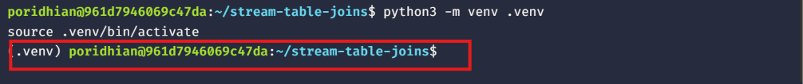
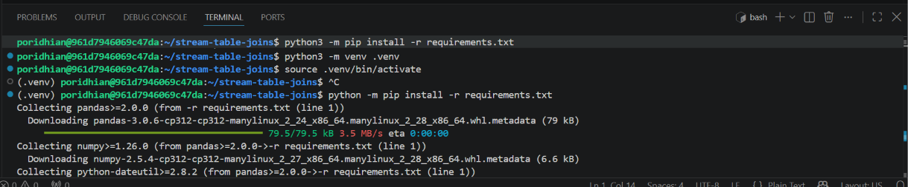
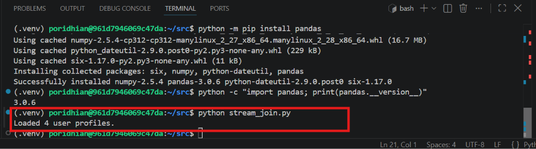
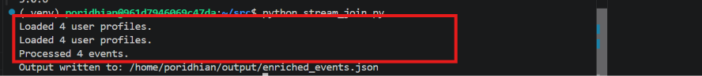

# Stream-Table Joins: Real-Time Clickstream Enrichment Using Broadcast Joins
**Level:** Intermediate  


## Introduction

At DataHive, the recommendation team receives thousands of click events as users browse an online store. Each event contains information such as the user ID, clicked product, and event type, but it does not include useful user features such as location, membership level, or age. The team already maintains these details in a small, relatively stable user profile table. To improve its recommendation features without performing a database lookup for every click, the team will load the profile table into memory and enrich incoming events using a broadcast join. By the end of this lab, students will build a standalone simulation of this streaming pattern and inspect the enriched events.


  


## Project File Structure

Ensure the project root contains the following files and directories:

```text
stream-table-joins/
├── data/
│   ├── events.json
│   └── users.csv
├── src/
│   └── stream_join.py
├── output/
│   └── enriched_events.json
├── requirements.txt
└── README.md
```

- `data/events.json` contains sample clickstream events.
- `data/users.csv` contains static user profile information.
- `src/stream_join.py` loads the profile reference table into memory and enriches events.
- `output/` stores the resulting enriched events (created automatically by the processor).
- `requirements.txt` lists required Python dependencies.
- `README.md` documents project setup and execution steps.

## Chapter 1 — Set Up the Environment

### Step 1: Initialize the project workspace

Open a terminal in your workspace and navigate into or initialize the `stream-table-joins` directory:

```bash
mkdir -p stream-table-joins
cd stream-table-joins
```

Create an isolated virtual environment and activate it:

**On Linux/macOS:**
```bash
python3 -m venv .venv
source .venv/bin/activate
```


**On Windows (PowerShell):**
```powershell
python -m venv .venv
.venv\Scripts\Activate.ps1
```


### Step 2: Define dependencies and project documentation

Create `requirements.txt` in the project root:

```text
pandas>=2.0.0
```

Install the dependency:

```bash
python -m pip install -r requirements.txt
```



In this step, the team prepares an isolated Python environment for the clickstream enrichment application. A virtual environment keeps the project's dependencies separate from system-level Python packages. Pandas is used to parse tabular reference data into an in-memory dictionary lookup.

## Chapter 2 — Prepare the Clickstream and Profile Data

### Step 1: Create the static user profile table

Create the `data` directory and add `data/users.csv`:

```csv
user_id,age,location,membership
u101,25,Dhaka,gold
u102,32,Chattogram,silver
u103,28,Sylhet,bronze
u104,35,Dhaka,gold
```

This CSV represents the reference dimension table maintained by DataHive. Each row describes a user and contains features that improve downstream analytics and recommendation algorithms. The `user_id` column acts as the primary join key. The table is compact and relatively stable, making it an ideal candidate for broadcast caching in memory.

### Step 2: Create sample clickstream events

Create `data/events.json` and add the following JSON array:

```json
[
  {
    "event_id": "e001",
    "user_id": "u101",
    "event_type": "click",
    "product_id": "p501"
  },
  {
    "event_id": "e002",
    "user_id": "u102",
    "event_type": "view",
    "product_id": "p502"
  },
  {
    "event_id": "e003",
    "user_id": "u103",
    "event_type": "click",
    "product_id": "p503"
  },
  {
    "event_id": "e004",
    "user_id": "u999",
    "event_type": "click",
    "product_id": "p504"
  }
]
```

These records represent continuous click events arriving from an online storefront. Each event identifies an interaction and product, but lacks user demographic features. The final event deliberately references `u999`, which is absent from the profile table. This enables testing how the join handles non-matching events without dropping them or raising runtime errors.

## Chapter 3 — Load the Static Table into Memory

Create `src/stream_join.py` and implement the profile loader:

```python
import json
from pathlib import Path

import pandas as pd

BASE_DIR = Path(__file__).resolve().parent.parent
DATA_DIR = BASE_DIR / "data"
OUTPUT_DIR = BASE_DIR / "output"


def load_user_profiles(csv_path: Path = DATA_DIR / "users.csv") -> dict:
    """Load the static reference table into an in-memory dictionary keyed by user_id."""
    profiles_df = pd.read_csv(csv_path)

    return profiles_df.set_index("user_id").to_dict(orient="index")


if __name__ == "__main__":
    user_profiles = load_user_profiles()
    print(f"Loaded {len(user_profiles)} user profiles.")
```

Test profile loading from the project root:

```bash
python src/stream_join.py
```

**Expected Console Output:**



The `load_user_profiles()` function reads the CSV and converts it into a nested dictionary indexed by `user_id`. In a distributed streaming system (such as Apache Flink or Apache Spark), this mirrors a **broadcast join**, where the small reference table is loaded once and distributed across all worker partitions rather than querying an external database for every message.

## Chapter 4 — Implement the Stream-Table Join

Update `src/stream_join.py` with the complete enrichment logic:

```python
import json
from pathlib import Path

import pandas as pd

BASE_DIR = Path(__file__).resolve().parent.parent
DATA_DIR = BASE_DIR / "data"
OUTPUT_DIR = BASE_DIR / "output"


def load_user_profiles(csv_path: Path = DATA_DIR / "users.csv") -> dict:
    """Load the static reference table into an in-memory dictionary keyed by user_id."""
    profiles_df = pd.read_csv(csv_path)

    return profiles_df.set_index("user_id").to_dict(orient="index")


def enrich_event(event: dict, user_profiles: dict) -> dict:
    """Enrich a single event by performing a key lookup against the in-memory profiles."""
    user_profile = user_profiles.get(event["user_id"])

    return {
        **event,
        "user_profile": user_profile,
        "profile_matched": user_profile is not None,
    }


def process_clickstream():
    """Execute the broadcast join pipeline over incoming clickstream events."""
    OUTPUT_DIR.mkdir(parents=True, exist_ok=True)
    events_path = DATA_DIR / "events.json"
    output_path = OUTPUT_DIR / "enriched_events.json"

    # Step 1: Pre-load reference table into memory (Broadcast Step)
    user_profiles = load_user_profiles()
    print(f"Loaded {len(user_profiles)} user profiles.")

    # Step 2: Ingest event stream
    with events_path.open("r", encoding="utf-8") as file:
        events = json.load(file)

    # Step 3: Stream-table join across all events
    enriched_events = [
        enrich_event(event, user_profiles)
        for event in events
    ]

    # Step 4: Write enriched events to output sink
    with output_path.open("w", encoding="utf-8") as file:
        json.dump(enriched_events, file, indent=2)

    print(f"Processed {len(enriched_events)} events.")
    print(f"Output written to: {output_path}")


if __name__ == "__main__":
    process_clickstream()
```

The `enrich_event()` function performs the join by looking up the profile for each event's `user_id`. When a profile exists, the event is augmented with the user's age, location, and membership tier. When no profile exists, the event is preserved with `"user_profile": null` and `"profile_matched": false`. Passing `user_profiles` explicitly keeps the function pure, modular, and easily testable.

## Chapter 5 — Run and Verify the Pipeline

Run the completed enrichment pipeline from the project root:

```bash
python src/stream_join.py
```

**Expected Console Output:**



### Inspect the output

Open `output/enriched_events.json`. The pipeline produces a JSON array containing all events augmented with user details:

```json
[
  {
    "event_id": "e001",
    "user_id": "u101",
    "event_type": "click",
    "product_id": "p501",
    "user_profile": {
      "age": 25,
      "location": "Dhaka",
      "membership": "gold"
    },
    "profile_matched": true
  },
  {
    "event_id": "e002",
    "user_id": "u102",
    "event_type": "view",
    "product_id": "p502",
    "user_profile": {
      "age": 32,
      "location": "Chattogram",
      "membership": "silver"
    },
    "profile_matched": true
  },
  {
    "event_id": "e003",
    "user_id": "u103",
    "event_type": "click",
    "product_id": "p503",
    "user_profile": {
      "age": 28,
      "location": "Sylhet",
      "membership": "bronze"
    },
    "profile_matched": true
  },
  {
    "event_id": "e004",
    "user_id": "u999",
    "event_type": "click",
    "product_id": "p504",
    "user_profile": null,
    "profile_matched": false
  }
]
```

### Key Verification Checks

1. **Profile Enrichment:** Verify that `u101`, `u102`, and `u103` accurately reflect their respective `age`, `location`, and `membership` from `users.csv`.
2. **Event Field Preservation:** Check that original fields (`event_id`, `user_id`, `event_type`, `product_id`) remain intact.
3. **Graceful Handling of Unmatched Keys:** Confirm that user `u999` remains in the stream with `"user_profile": null` and `"profile_matched": false` without crashing the processor.

## Conclusion

In this lab, the DataHive team enriched clickstream events with static user profile information using a stream-table join pattern. Loading reference profiles into an in-memory dictionary eliminated per-event database queries and simulated how distributed stream engines perform broadcast joins.

### Production Considerations

In production streaming architectures (e.g., Apache Flink, Kafka Streams, Spark Structured Streaming):
- **Memory Footprint:** Broadcast joins are ideal for small, slowly changing dimension tables (typically tens of megabytes). For massive user bases (millions of users), distributed key-value stores (e.g., Redis, RocksDB) or partitioned state stores are preferred.
- **Data Freshness & CDC:** In real-world systems, user profiles are not completely static. Change Data Capture (CDC) streams (e.g., Debezium) can continuously update the in-memory cache as profile changes occur.
- **Fault Tolerance:** In-memory state in distributed engines is backed by checkpointing to persistent storage (like S3 or GCS) to ensure seamless recovery without event loss.
